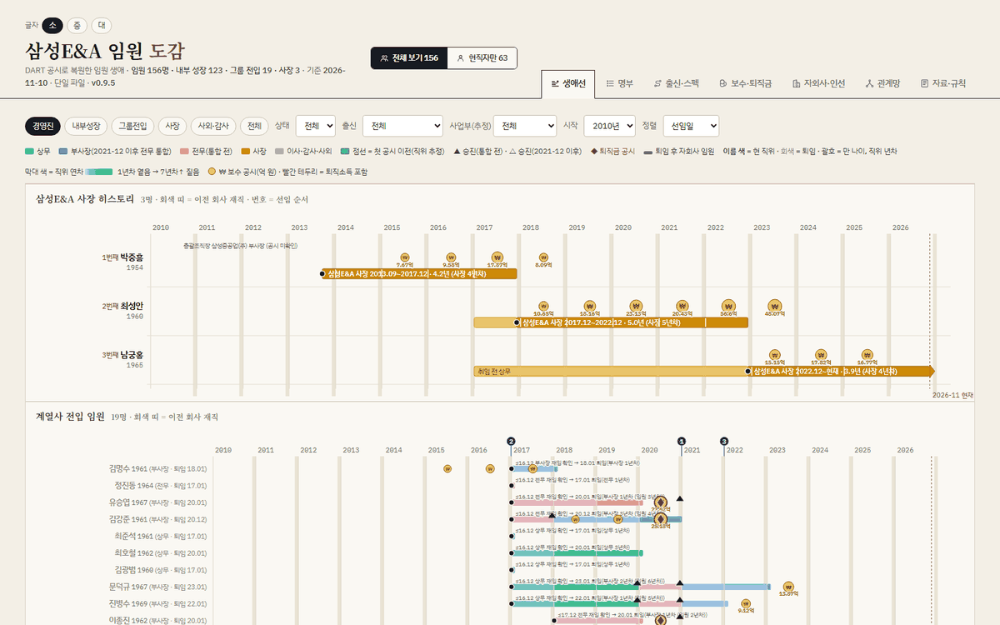
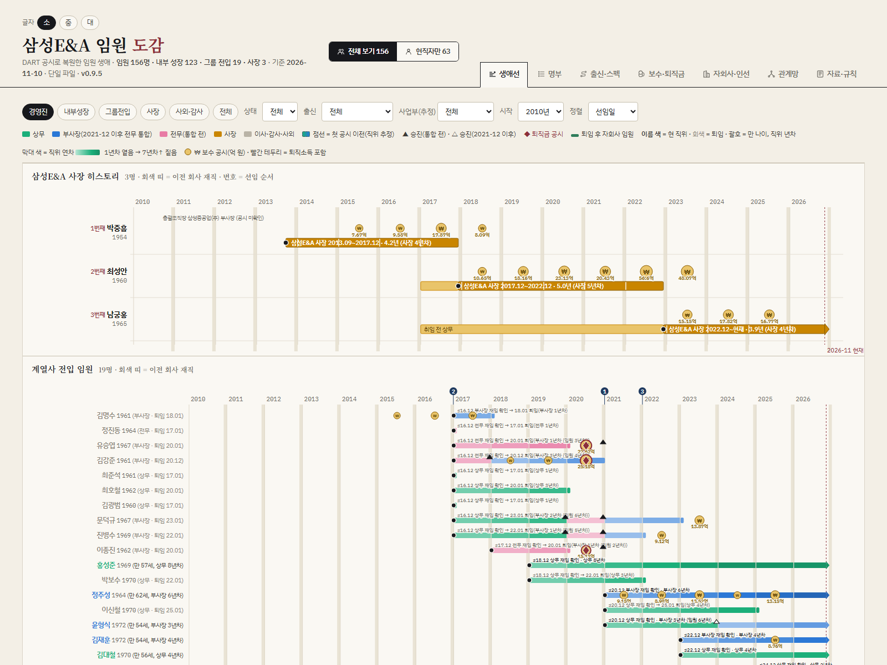
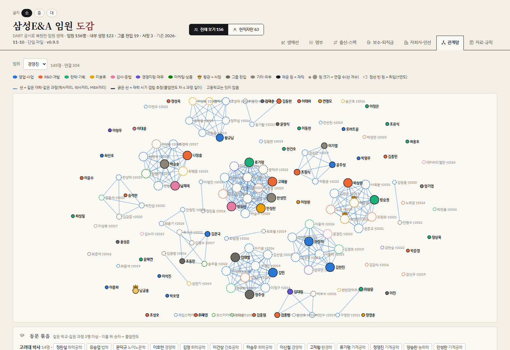
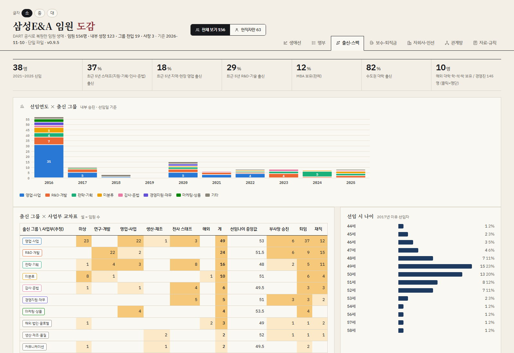
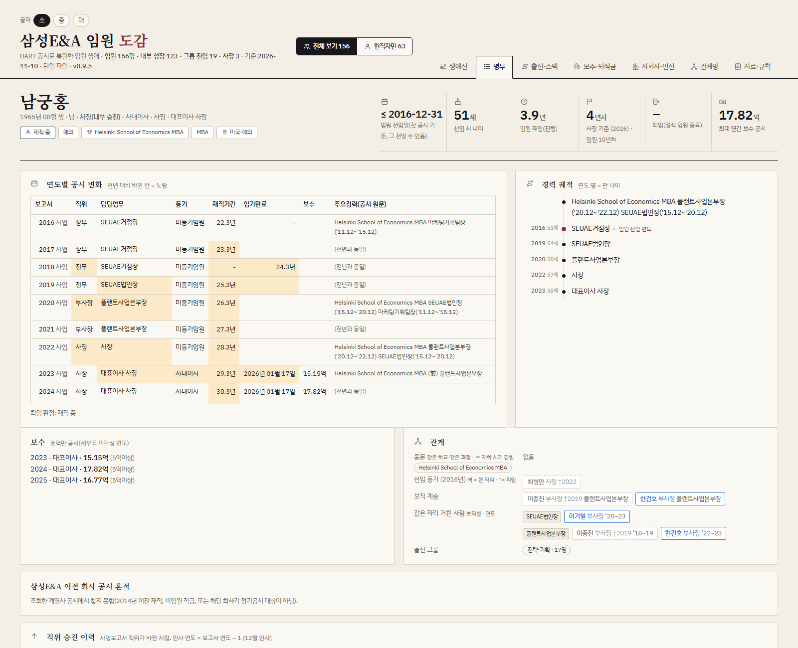
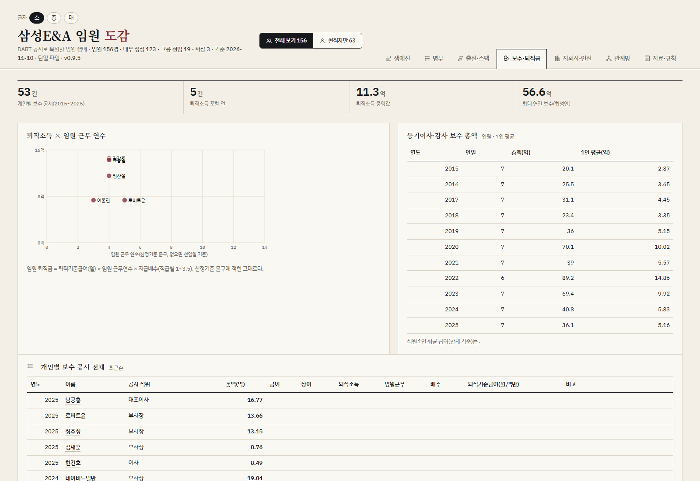
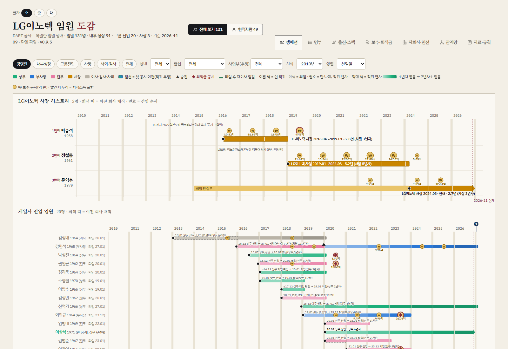
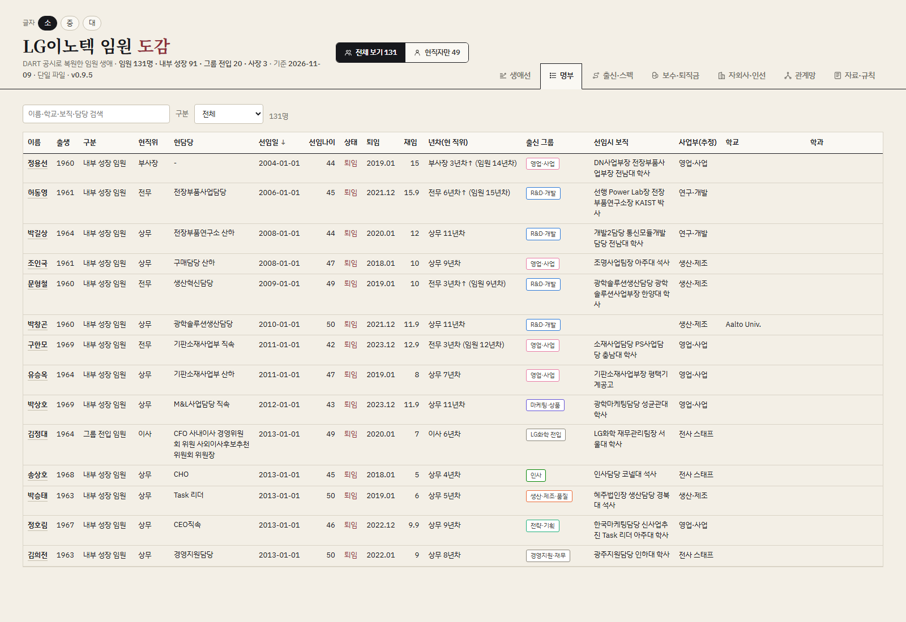

# dart-chaebol-exec-chronicle

The Korean chaebol executive chronicle, built from DART filings

**Who actually runs Korea's chaebol? Every executive, every degree, every paycheck, every exit. Rebuilt from public filings with one command.**

[한국어](README.ko.md) · English



---

Samsung, LG, SK, Hyundai. A few thousand people sit at the top of the companies that make the phones, chips, cars and batteries the world runs on. You can name the chairmen. Can you name the 131 executives of LG Innotek, when each was promoted, where they went to school, and which of them got dropped from the annual report last December?

Korean conglomerate executives are among the most-watched and least-documented people in the country. Every December the "year-end personnel announcement" makes headlines for a day, then the trail goes cold. Yet the whole record is public. Every listed company files executive rosters, individual pay above 500 million won, severance, and CEO changes with **DART**, Korea's electronic disclosure system. It is just buried in hundreds of quarterly and annual reports, in inconsistent tables, with names spelled differently from year to year.

This tool digs it all up and puts it back together. You type a company name. It pulls every executive table, pay disclosure, report original and CEO-change filing from DART, resolves the same person across years, dates every appointment, promotion and exit, traces CEO succession, links university classmates, and renders everything into **a single HTML file you open by double-clicking**.

Pure Python standard library. No dependencies, no server, no database.

## Questions you can now answer

- At what age does someone become an executive at a Korean conglomerate? (LG Innotek, 2017 onward: 47 and 50 are the two biggest cohorts.)
- How long does a 상무 (VP) last before quietly disappearing from the filings?
- Does the CEO rise from inside or get parachuted in from the group? (LG Innotek: two parachutes from LG Electronics and LG Chem, then one insider.)
- Which schools? Which majors? How much of the C-suite is Seoul-National-University engineering? How many MBAs? (LG Innotek: 62% Seoul-area universities, 1% MBA.)
- Who was promoted from R&D versus sales versus staff functions? (Of 36 appointed in 2021–2025: 39% R&D, 22% staff, 0% field sales.)
- What does a president take home, and what severance does he leave with? (Current LG Innotek CEO: 9.91억 → 9.39억 → 12.51억 won, 2022–2025.)
- Who went to the same university program at the same time, and are they now in the same boardroom? (Samsung E&A: 14 Korea University BAs among the executives, 304 classmate links in total.)
- Which post is the launch pad: who held the job before the current CEO, and where did they end up?

Every number links back to the filing it came from.

## What it looks like

**Samsung E&A** (삼성E&A), 156 executives. Three CEOs in a row, each tenure bar carrying every pay filing. The second CEO's disclosed pay climbs from 10.65억 to 56.6억 won in his final year.



Who studied with whom. 304 classmate links; the dense cluster in the middle is Korea University chemical engineering.



Where the executives came from and how old they were when appointed. 2016 alone minted 55 executives, 31 of them from sales.



One person, every year of disclosure side by side: title, duty, registration, tenure, pay, career text. Yellow cells are what changed from the year before.



Pay and severance: who got severance after how many executive years, board pay totals, every individual pay filing.



**LG Innotek** (LG이노텍), 131 executives, built from scratch in about a minute with `python add_company.py LG이노텍`.





Seven views in one file:

| View | What it shows |
|---|---|
| Lifelines | Every executive as a tenure bar, grouped into CEOs / group transfers / home-grown. Color by title, shade by years in title, markers for promotions and severance filings. Labels carry birth year, age and years in current title |
| Roster | Sortable, filterable table: birth year, track, title, duty, appointment date, retirement, tenure, origin unit, division, school, degree, pay filings |
| Person page | Year-by-year disclosure diff, career path, promotion history, pay and severance basis, predecessors and successors in the same post, same-cohort appointees, classmates |
| Origins & profile | Appointment year × origin unit, age at appointment, degree, region, school, major |
| Pay & severance | Individual pay filings, severance × years as executive, board pay totals, headcount |
| Network | University classmates (same school + same program only: BA with BA, MS with MS, MBA with MBA), overlap-in-time estimate, domestic vs overseas |
| Sources & rules | Where each number comes from, decision rules, headcount by title and year, known limits |

## Quick start

Python 3.10+. Nothing to install. (`check_app.py`, the optional render check, uses Edge on Windows.)

```
# 1) A free DART API key from https://opendart.fss.or.kr
set DART_API_KEY=your_key            # macOS/Linux: export DART_API_KEY=...
#    or save it as dart_key.txt in the repo root (git-ignored)

# 2) One line
set PYTHONUTF8=1                     # Windows console only
python add_company.py LG이노텍
```

Output: `dist/App_LG이노텍_<version>.html`. Default range is the last ten fiscal years (2016–). Expect 1–20 minutes depending on how many reports the company has filed. Try `삼성전자`, `SK하이닉스`, `현대자동차`, `LG에너지솔루션`, or any of the ~2,600 listed companies.

### Options

| Option | Meaning | Example |
|---|---|---|
| `name` or `corp_code` | Company name as registered in DART (partial match, listed companies first) or its 8-digit DART code | `삼성E&A`, `00126308` |
| `--slug` | Folder name (ASCII). Default: derived from the English name | `--slug sena` |
| `--group` | Group preset (삼성·LG·SK·현대·롯데·한화·CJ·none). Auto-detected when the name starts with a group name | `--group 삼성` |
| `--self` | Former names / aliases of the company itself (recognized as in-house posts, excluded from the affiliate list) | `--self 삼성엔지니어링` |
| `--first` | First fiscal year (default 2016) | `--first 2010` |
| `--logo` | Header logo file (optional) | `--logo logo.svg` |
| `--no-fetch` | Skip fetching; re-parse, rebuild and re-render only | |

Renamed companies (e.g. 삼성엔지니어링 → 삼성E&A) keep the same DART code: use the current name and put the old one in `--self`.

## Use it from Claude Code (skill + MCP)

The repo ships as a Claude Code plugin: a **skill** that knows the workflow and the data fields, and an **MCP server** (`mcp_server.py`, standard library, stdio) with nine tools: `search_company`, `build_company` (runs in the background), `build_status`, `list_companies`, `company_summary`, `query_people`, `find_person`, `ceo_succession`, `classmates`.

```
/plugin marketplace add desika/dart-chaebol-exec-chronicle
/plugin install dart-chaebol-exec-chronicle@dart-chaebol-exec-chronicle
```

Then just talk:

```
> LG이노텍 임원 도감 만들어 줘
> 현대자동차 사장 계보랑 평균 취임 나이 알려 줘
> 삼성전자에서 2021년 이후 선임된 상무 중 서울대 출신만 뽑아 줘
```

Without the plugin, cloning the repo and starting `claude` inside it registers the MCP server from `.mcp.json`; point Claude at `skills/dart-chaebol-exec-chronicle/SKILL.md` for the workflow. Any other MCP client works with:

```json
{ "mcpServers": { "dart-chaebol-exec-chronicle": { "command": "python", "args": ["/path/to/dart-chaebol-exec-chronicle/mcp_server.py"], "env": { "DART_API_KEY": "your_key", "PYTHONUTF8": "1" } } } }
```

## Pipeline

`add_company.py` runs these in order. Each can also be run alone with `COMPANY=<slug>` in the environment.

| Stage | Script | Input → output |
|---|---|---|
| Fetch | `fetch_dart.py` | Executive-status API `exctvSttus` (annual + every quarterly/half-year report) → `exec_raw.json`, SQLite |
| Fetch | `fetch_docs.py` | Report originals `document.xml` (zip) → `docs/*.xml`; pre-2013 reports located via `list.json` |
| Fetch | `fetch_pay.py` | Five pay APIs → `pay_raw.json` |
| Fetch | `fetch_ceo_changes.py` | "Change of representative director" ad-hoc filings → `ceo_changes.json` |
| Fetch | `fetch_affiliates.py` | (if configured) subsidiary audit reports, executive changes, group status → `affil_raw.json` |
| Parse | `parse_exec_docs.py` | Executive tables in report originals → recovers unregistered executives, merged into `exec_raw` |
| Parse | `parse_pay.py` | "Basis of individual pay" tables → `pay_detail.json` |
| Analyze | `analyze.py` | Person resolution (name + birth month), appointment/retirement/education/career parsing → `persons.json/csv` |
| Build | `build_data.py` | Tracks, origin units, divisions, CEO succession, classmate edges, events → `app_data.json` |
| Build | `build_affil.py` | CEO tenure table, subsidiary tenure tables and prediction board → `affil.json` |
| Render | `render_app.py` | `app_template.html` + data → `dist/App_<company>_<version>.html` |
| Check | `check_app.py` | Headless Edge opens every person page and all seven views, reports JS errors |

`careerlib.py` is the career-text parser (school, major, degree, splitting run-on career strings). `company.py` loads the configuration.

## After the first run: fix the origin grouping

`companies/<slug>/data/group_map.json` maps "post held at appointment → origin unit". It starts with twelve generic rules (sales, R&D, management support…) so company-specific vocabulary lands in "unclassified". `add_company.py` prints the unclassified list at the end; add rules (`rules`, first match wins) or per-name `overrides`, then rebuild:

```
set COMPANY=lginnotek
python build_data.py && python build_affil.py && python render_app.py
```

All `config.json` keys (self/group name regexes, year range, division rules, subsidiaries, events) are documented in [companies/README.md](companies/README.md).

## How the decisions are made

- **Same person** = name (whitespace removed) + birth year-month. Birth-month typos are absorbed by merge rules.
- **Appointment date** = earliest start date among all "tenure" fields across reports. If none, end of the first year disclosed (shown with ≤).
- **Retirement** = if severance pay is disclosed in the same year as the person's last appearance, December of that year; otherwise January. No severance filing → December of the last year seen. Quarterly reports narrow mid-year moves to the quarter.
- **CEO** = representative director of the company itself (by title or by duty prefix; "assistant to the CEO" excluded) or a CEO-change filing. Term ends when the successor is appointed. Co-CEOs are tracked individually.
- **Track** = CEO (group-dispatched / promoted from inside) · transferred from group · home-grown · outside director / auditor.
- **Years in title** = counted from the personnel round of the last promotion (CEOs from appointment). Samsung-group companies apply the December 2021 abolition of the 전무 (SVP) rank (`title_merge_year`).
- **Classmates** = same school + same program. High-school ties are not linked. Within program length of each other → "likely overlapped".

Details and exceptions are in the app's "Sources & rules" view and in code comments.

## Limits

- Companies with few annual reports (unlisted, small) reconstruct poorly. Unregistered executives are only in the report originals for some companies.
- Companies that write tenure as "N years M months" get estimated appointment dates (≤).
- Hire year, team-lead year and performance ratings are not disclosed. Origin unit and division are inferred from text.
- Individual pay under 500 million won is not disclosed, so severance for most VP-level executives is invisible.
- Seven group presets only. For other groups use `--group none` and fill `group_regex` yourself.

## About the data

The tool reads only periodic and ad-hoc filings that DART makes public. The repository contains code only; everything it produces (configs, fetched data, HTML) stays on your machine (`.gitignore`). Decisions about sharing output are yours.

## Where this is going

The next step is a model. Run the same rules over many companies, stack the careers, and learn how promotion and exit probabilities depend on age at appointment, years in title, origin unit, education and group affiliation: a foundation model of the Korean conglomerate executive career. Issues and PRs welcome.

- `group_map.json` vocabulary for specific companies, new group presets
- Parsers for older or oddly-formatted report tables
- Tenure and education text edge cases
- The model itself: feature design, training scripts

## License

MIT. See [LICENSE](LICENSE).
